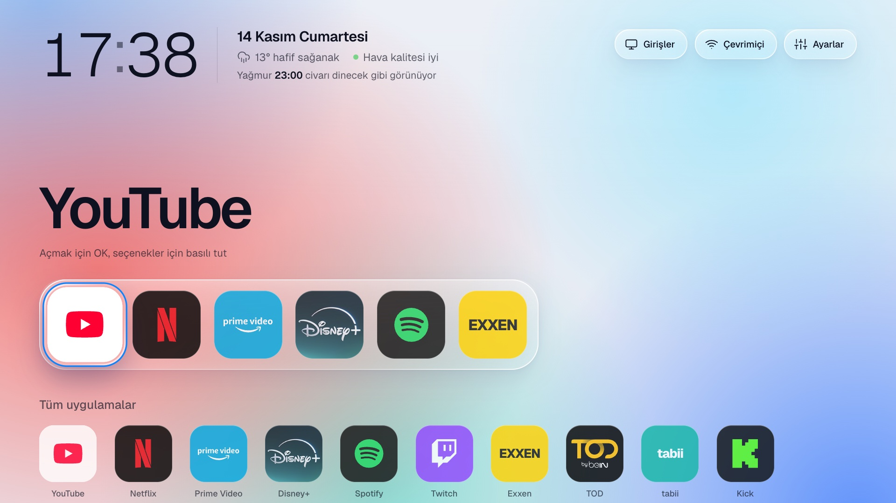
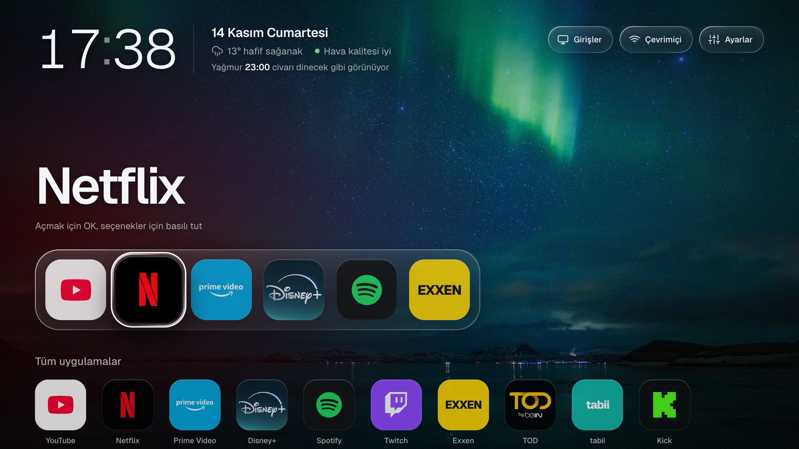
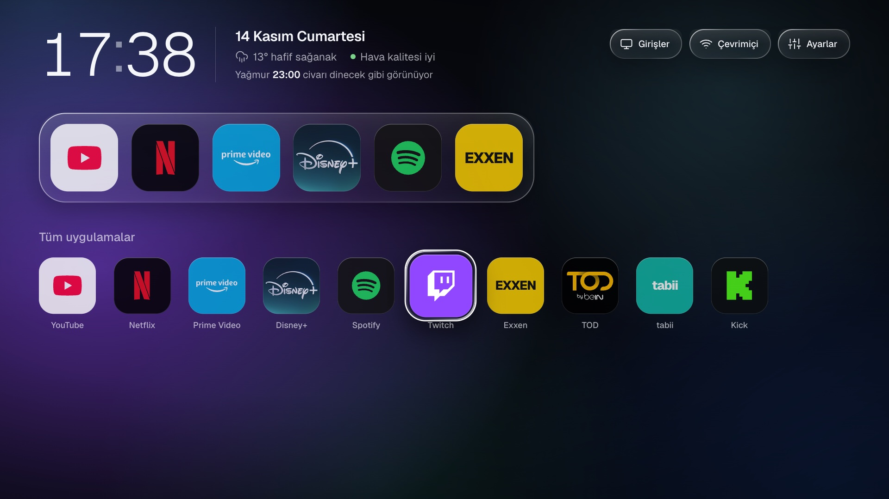
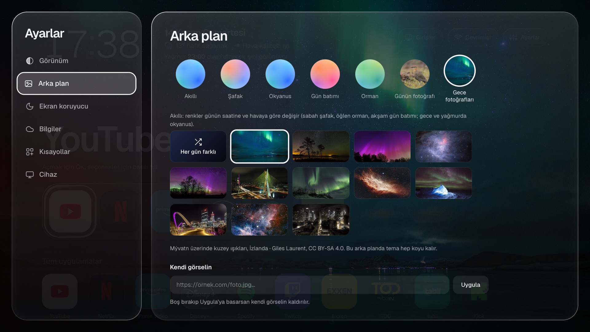
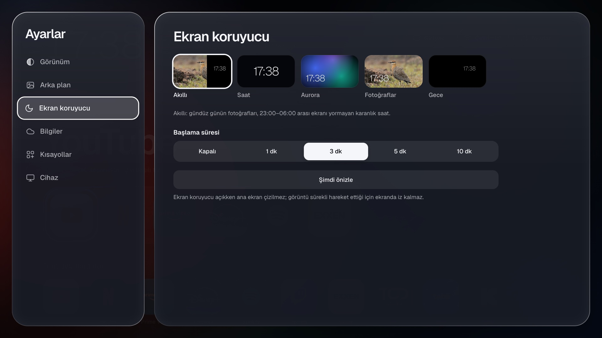
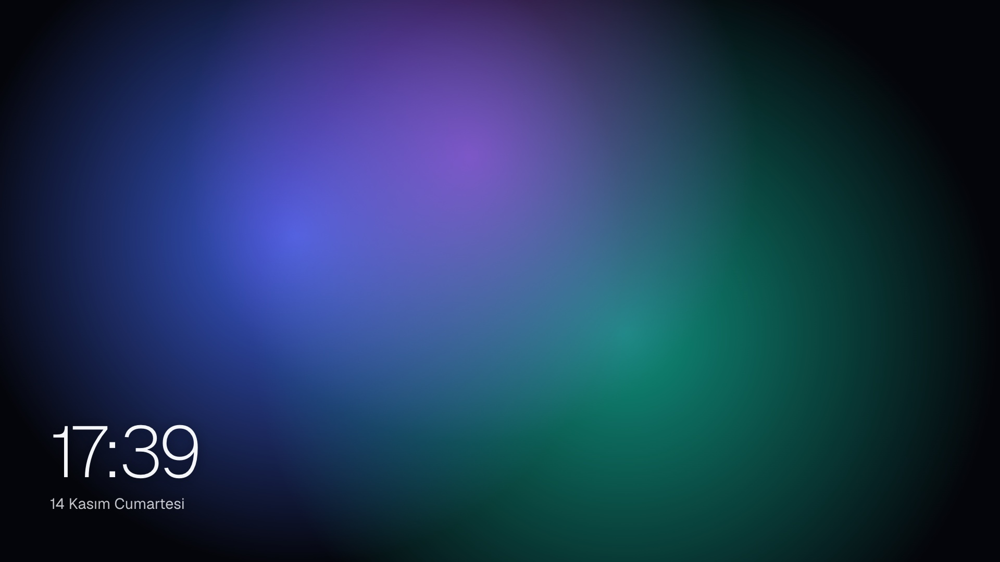

# Ana Ekran: Samsung Smart Monitor için reklamsız ana ekran

Samsung Smart Monitor M5 (LS32AM500, Tizen 5.5) için yazılmış, reklamsız, sade ve kumandayla
kullanılan bir ana ekran. Tek bir `index.html` dosyası: tarayıcıda açılabilir ya da Tizen
uygulaması olarak monitöre kurulabilir. Tizen uygulaması olarak kurulunca kutucuklar gerçek
YouTube, Netflix, Prime Video uygulamalarını açar.



## Ekran görüntüleri

| | |
|---|---|
|  |  |
| Gece fotoğrafı arka planı, koyu tema | Tüm uygulamalar: saat yerinde kalır, liste yukarı kayar |
|  |  |
| Ayarlar → Arka plan: 12 koyu fotoğraf | Ayarlar → Ekran koruyucu |
|  | |
| Aurora ekran koruyucu | |

Ekran görüntülerindeki fotoğraflar Wikimedia Commons'tan: "Mývatn üzerinde kuzey ışıkları" Giles Laurent,
CC BY-SA 4.0; diğer küçük önizlemelerin yazar ve lisansları uygulamada fotoğrafın altında yazar.

## Özellikler

- **Saat kümesi:** büyük ince saat; yanında tarih, hava durumu, hava kalitesi ve 8 saniyede bir
  değişen **akıllı özet** (yağmur ne zaman başlayıp dinecek, gün batımı, yaklaşan resmî tatil, döviz kuru)
- **Dock ve tüm uygulamalar:** marka logolu kutucuklar, odaktaki uygulamanın adı büyük yazıyla,
  arka plan o uygulamanın renginde parlar; tek cam çerçeve kutucuktan kutucuğa yaylanır
- **Kumanda:** ok tuşları gezer, OK açar, OK'u basılı tutmak seçenekleri açar (dock'a ekle, taşı, kaldır),
  Geri bir üst seviyeye döner
- **Tema:** Otomatik (gün doğumunda açık, gün batımında koyu), Açık, Koyu, Siyah; şeffaf Liquid Glass görünüm
- **Arka plan:** Akıllı (saate ve havaya göre renk), 4 renk paleti, Wikimedia günün fotoğrafı,
  12 koyu gece fotoğrafı ya da kendi görselin
- **Ekran koruyucu:** Akıllı (gündüz fotoğraflar, gece karanlık saat), Saat, Aurora, Fotoğraflar, Gece
- **Akıllı öneriler:** hangi saatte hangi uygulamayı açtığını yalnızca cihazda öğrenip o saatte öne çıkarır
- **HDMI:** monitöre cihaz takılınca "Bu girişe geç" önerir (Tizen uygulamasında)
- **Hafif mod:** zayıf TV işlemcileri için sabit arka plan ve sade gölgeler (monitörde kendiliğinden açık)
- Eski tarayıcı motoru (Chromium 69, ES5) için yazıldı; anahtar gerektiren servis yok

## Kurulum

Ayrıntılı rehber: [KURULUM.md](KURULUM.md)

- **Tarayıcıda denemek:** klasörde `python3 -m http.server 8080` çalıştır, `http://localhost:8080` aç.
- **Monitöre Tizen uygulaması olarak:** Tizen Studio komut satırı araçları, Samsung Certificate Extension
  ve monitörde Geliştirici Modu gerekir. Samsung sertifikası `samsung-m5` adıyla oluşturulduktan sonra:

  ```bash
  ./tizen/kur.sh <monitör-ip>
  ```

  Betik bağlanır, paketler, imzalar, yükler ve başlatır.

## Dosyalar

| Dosya | Ne işe yarar |
|---|---|
| `index.html` | Ana ekranın tamamı (HTML, CSS, JavaScript) |
| `tizen/config.xml` | Tizen uygulama tanımı ve yetkileri |
| `tizen/icon.png` | Uygulama ikonu |
| `tizen/kur.sh` | Monitöre tek komutla kurulum |
| `tizen/kumanda.js` | Mac'ten monitöre sanal kumanda tuşu gönderir |
| `KURULUM.md` | Reklam ayarları, DNS, tarayıcı ve Tizen kurulum rehberi |

## Bilinen sınırlar

- Kumandadaki **Home** tuşu Samsung'un sistemine ayrılmıştır; bir uygulamaya bağlanamaz. Ana Ekran'ı
  Samsung ana ekranındaki uygulama satırının başına almak en pratik çözümdür.
- Tizen geliştirici kurulumu Samsung sertifikası gerektirir; sertifikalar bu depoda tutulmaz.

## Teşekkür ve lisanslar

Üçüncü taraf kod, veri ve görsellerin listesi: [THIRD_PARTY_NOTICES.md](THIRD_PARTY_NOTICES.md).
Marka adları ve logoları sahiplerine aittir; yalnızca uygulamaları tanıtmak için kullanılır.
